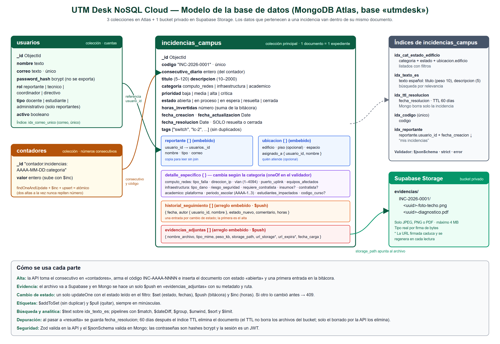

# UTM Desk NoSQL Cloud — Fase 1

Proyecto de la unidad II de **Bases de Datos en la Nube** (Desarrollo de Software Multiplataforma, grupo 7A, Universidad Tecnológica Metropolitana).
Docente: Lizandro Israel Reyes Carrillo.

**Integrantes:** Arroyo León Luis Diego · Can Domínguez Víctor Emmanuel · Montalvo Canché Emir Emanuel · Vargas Guzmán Kevin Aarón.

## Documento

**[Fase 1: avances técnicos (PDF)](entregables/Fase1_UTM-Desk-NoSQL-Cloud.pdf)** — selección y justificación de tecnologías, requisitos funcionales y no funcionales, y el modelo de datos JSON/BSON con un ejemplo por categoría y el `$jsonSchema` de la base de datos en MongoDB Atlas.

## Diagrama de la base de datos

Tres colecciones en MongoDB Atlas (`usuarios`, `incidencias_campus` y `contadores`), los índices de la colección principal y el bucket privado de Supabase donde se guardan las evidencias.
